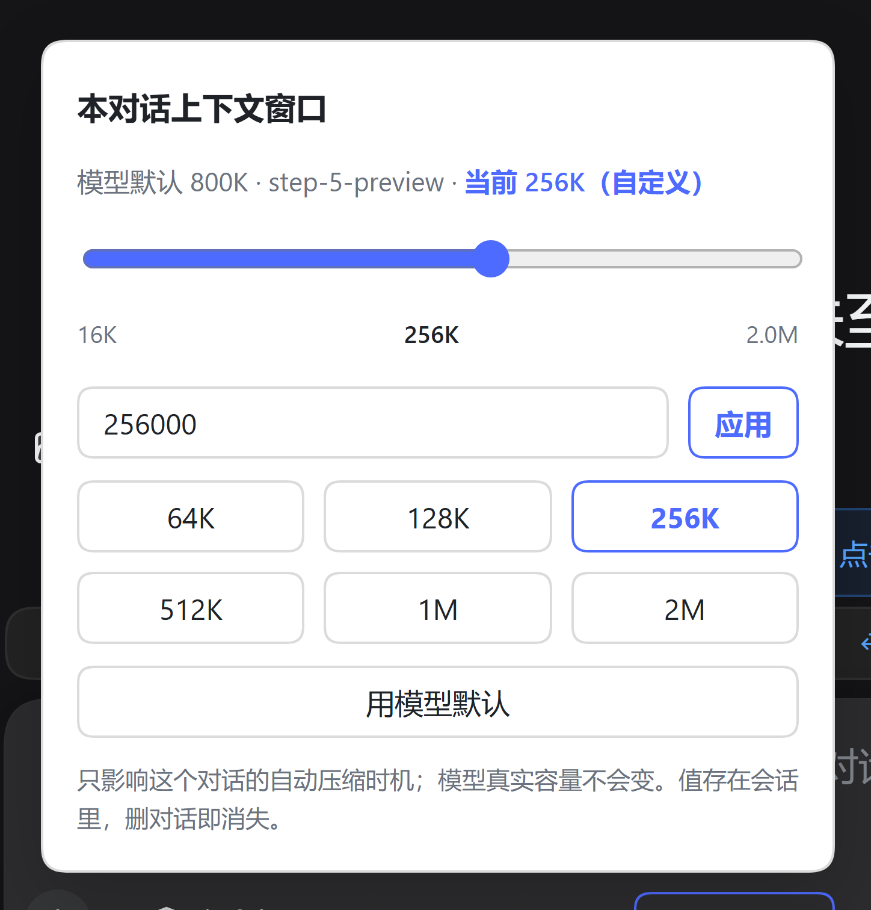
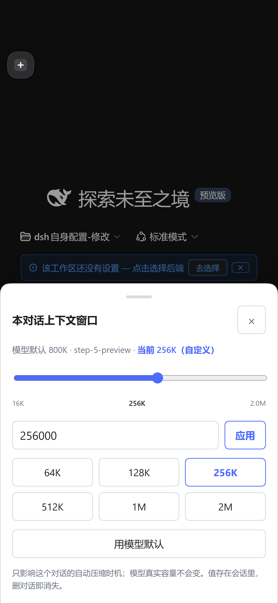

# dsh-context-window

**给每个对话一个独立的上下文窗口。**

不改 `settings.yaml` 里的模型配置，只在会话日志里存一份覆盖值：切换对话、重开 DSH、导出导入都保留，删对话即消失，并且**即时**改变这个对话的自动 compact 触发线，界面上的上下文环也跟着变。

---

## 它解决什么

DSH 的自动压缩触发线是一条算式：

```
thresholdTokens = floor(contextWindow × thresholdRatio)
```

（`dsh-compaction-basic/lib/index.js:111` 算阈值，`:883` 取窗口，`:884` 比较）

问题是**两个因子都不是按对话给的**：

| 因子 | 来源 | 粒度 |
|---|---|---|
| `contextWindow` | adapter 的 model catalog（`dsh-llm-deepseek/lib/index.js:1566`，默认 `1e6`） | provider + model，写死在 `settings.yaml` |
| `thresholdRatio` | `compaction-basic` 插件配置（默认 `0.8`） | 全局，或 `modelPolicies[]` 按 provider+model |

于是现实里的尴尬是：**1M 窗口的模型，前 800K 都不压缩。** 短对话被历史拖着走，token 白烧；想早点压缩，只能去改全局配置，把所有对话一起改掉。

本插件补的就是缺的那一层：**会话级 `contextWindow` 覆盖**。

把某个对话从 1M 调到 256K，这个对话就会在 `256K × 0.8 ≈ 205K` 开始压缩，而**其它对话和模型配置一个字节都不动**。

---

## 截图

### 桌面

输入框右侧出现一个胶囊，点开是锚在按钮上方的气泡面板：



### 手机（≤640px）

同一个座位，换成底部抽屉：遮罩、拖拽把手、`×` 关闭，避让 `safe-area-inset-bottom`，档位三列排布，触控目标 ≥40px：



---

## 安装

```sh
dsh plugin --profile web add github:qq-24/dsh-context-window
```

然后**重启 dsh web**（宿主侧代码不热载）。重启完刷新页面即可。

要求：DSH ≥ 0.1.2-rc.1，Node ≥ 22。

## 用法

输入框右侧的胶囊就是入口：

| 形态 | 用模型默认 | 有会话覆盖 |
|---|---|---|
| 桌面（>640px） | `上下文 默认 1.0M` | `上下文 256K` |
| 手机（≤640px） | `ctx 1.0M` | `ctx 256K` |

> 手机上刻意保留 `ctx` 前缀：纯数字会和 DSH 自带的上下文用量计（`4/6` 那种）混在一起，认不出是哪个控件。

### 面板里能做什么

- **滑块**：16K ~ 2M，**对数刻度**——线性刻度下 16K~64K 会挤在最左边一丁点，对数刻度让整个行程手感均匀
- **数字输入**：任意精确值，回车或点「应用」生效
- **预设档位**：64K / 128K / 256K / 512K / 1M / 2M
- **用模型默认**：清除覆盖，回到 adapter 那份值
- **对比行**：`模型默认 X · 模型名 · 当前 Y`，超过模型默认时会标黄

### 交互约定

**拖动滑块只是预览**——把手位置和数字实时跟随，但**不会**写入；只有点「应用」或数字框回车才真正生效。这样做的原因是每帧提交一次 RPC 会把宿主刷爆，而且误触一下滑块就改掉压缩时机也太容易出事。

---

## 设计边界

这几条是产品决策，不是技术限制：

- **不限制、仅提示**：允许把窗口设得比模型真实容量大。插件**不做钳制**，只在 UI 上标黄警告。理由：调大调小都应该由用户决定，插件替用户猜容量反而添乱。
- **不改 settings**：模型默认值永远是 adapter 那份，覆盖只是会话级叠加，随时可清除。
- **可增可减**：改的是 compact 判定用的窗口，不是模型真实容量，所以两个方向都生效。
- **即时生效**：不需要重启，下一条消息就走新阈值。
- **随会话走**：值存在会话日志里，重开、fork、导出导入都带着；删对话就跟着删，不留孤儿文件。

> ⚠️ **调高超过真实窗口会撞墙。** `contextWindow` 不只是压缩线参数，它还是 `request/context` 事件的记录值和 pi-ai 溢出检测的基准。设成比真实容量大，压缩永远不触发，直到 provider 返回上下文超限的 400。**这是唯一会咬人的地方**，所以 UI 里给了显式警告。

---

## 怎么做到的（不改 DSH 核心）

核心难点：**压缩判定和界面上下文环读的是两个不同的窗口来源**。

| 读者 | 读哪里 | 影响 |
|---|---|---|
| `compaction-basic` | `llm.resolveModelInfo(...).context.contextWindow`（`:879`） | 自动压缩在什么水位触发 |
| `token-meter`（界面上下文环） | `request/context` 事件的 `data.contextWindow`（`:373`） | 环的分母显示多少 |

只改其中一个，症状就是「压缩线动了但环不动」——用户会以为持久化坏了。所以有两条独立的接入路径。

### 路径一：压缩判定（AsyncLocalStorage）

`agent/pre-step` 是 **waterfall** 事件（`dsh-agent/lib/types/runtime-types.d.ts:237`），cordis 的 waterfall 是"每个 listener 包住链条的剩余部分"（`cordis/lib/index.js:317-325`）：

```
1. 用 prepend:true 把本插件挂到 pre-step 链最前面
2. 在 listener 里 AsyncLocalStorage.run(session, () => next())
   → 后续所有 listener（含 compaction-basic）都跑在这个 async 上下文里
3. 包一层 llm.resolveModelInfo，在 ALS 上下文内把 context.contextWindow 换成会话覆盖值
```

compaction-basic 完全不知道自己被改了。

### 路径二：界面上下文环（改会话读写两端）

环的分母来自 `request/context` 事件，它由 agent-loop 在 step 主体里写：

```js
const contextWindow = preparedCall?.context?.contextWindow;            // :757
const previousContext = session.requestContext();                      // :763
if (previousContext?.contextWindow !== requestContext.contextWindow)   // :764
  session.append('request/context', requestContext);
```

`preparedCall` 由 `llm.prepareCall()` 在 `:726` 造，**在 step 主体里**。而 DSH 没有任何能包住整个 step 的钩子——`agent/pre-step` 的 `next()` 返回 `PreStepDecision`（进不进这一步），`agent/request` 的 `next()` 返回 config，都在 step 主体之前返回。所以 **ALS 够不到 `prepareCall`**，`LlmCallConfig` 里也没有 `sessionId` 字段可以反查会话。

只能改会话对象本身，而且必须**读写两端一起改**：

- `session.requestContext()` 读 → 返回覆盖值，让 `:764` 判断"变了"
- `session.append` 写 → 落盘前把 `contextWindow` 换成覆盖值

> 为什么不能只拦 `append`：`preparedCall` 给的值恒等于原始值，`:764` 判断恒为"没变化"，agent-loop **压根不调 `append`**，拦不到任何东西。实测证据：一个 9246 事件的会话里 `request/context` 只有 1 条（停在会话开头）。

代价：每次请求都会多写一条 `request/context`（比较恒不等）。事件很小，可接受。

### 持久化

写进**会话日志**，不碰 `settings.yaml`：

| 事件 | 负载 | 含义 |
|---|---|---|
| `context-window/set` | `{ window: number }` | 该会话的自定义窗口 |
| `context-window/clear` | `{}` | 清除覆盖，回到模型默认 |

DSH 核心明确接受插件自定义事件类型（`dsh-session/lib/types/index.js:106-108`："SessionEventMap is merge-extensible; plugin-owned events carry no core message"），envelope 校验只要求 type 是 string（`:159-165`）。写入时带 `ignorable: true`，避免被 DSH 的未知事件处理误伤。

**并发安全**：ALS 按 async 链隔离，主对话、子代理、goal 轮次同时 pre-step 不会串值（离线测试专门验证）。路径二的读写 patch 挂在各自的 session 实例上，天然按会话隔离。

**刻意不替换官方 `compaction-basic`**：它是 45KB 实现，含 `assertNoActiveCompaction`、`toolPairingBalancedBefore/After`、`surface replaceGeneration`、checkpoint 约束等不变量，且 `selectCompactableRange` 未从 `dsh-compaction` 导出。抄错的失败形态不是报错，而是"会话看起来正常、恢复时校验失败"。压缩动作始终由官方插件执行，本插件只提供窗口值。

---

## 验证状态

| 项 | 状态 |
|---|---|
| 语法检查（index / client / typert） | ✅ `node --check` |
| `readWindow` 日志解析（set/clear/穿插/非法值） | ✅ 8/8 |
| ALS + `resolveModelInfo` 包装（上下文内/外） | ✅ 4/4 |
| 并发隔离（两会话交错 pre-step） | ✅ 2/2 |
| waterfall prepend 语义（compaction 看到覆盖值） | ✅ 3/3 |
| `apply()` 冒烟（注册/patch/服务/卸载还原） | ✅ 23/23 |
| client 契约（codec / inject / call 信封） | ✅ 19/19 |
| 配置树包含本插件 | ✅ `dsh web --dump-config` 可见 |
| 桌面 UI 渲染 + 打开面板 + 点档位生效 | ✅ 无头 CDP 实测 |
| 手机 UI（390×844 DPR2） | ✅ 胶囊 `ctx 256K`、抽屉、6 档位、`×` 关闭 |
| **跨刷新持久化** | ✅ 二次探测直接读到上次设的值 |
| **界面上下文环跟随** | ✅ 日志实证：`request/context` 的 `contextWindow` 为设定值 |
| 滑块交互契约（拖动不提交 / 把手跟手 / 应用才生效） | ✅ 专用测试 |
| zod 解析失败的兜底（不炸启动） | ✅ 无 `node_modules` 目录实测 |
| **compact 真实提前触发** | ⬜ 机制已被集成断言覆盖；真实触发需长对话观察 |

### 亲眼确认 compact 线动了

挑一个不重要的对话，把窗口设成 `16K`，连发几条长消息：

- **生效**：DSH 自带用量计走到约 `13K`（16K × 0.8）就触发压缩
- **没生效**：一直涨到几十 K 都没压缩

对照组：同一个模型在别的对话里要等到 `800K`（1M × 0.8）才压缩。两边一对比就确定覆盖真的进了判定路径。

---

## 排障

按这个顺序查，每一条都对应一个真实踩过的坑。

### 1. 插件装了我看不到控件

先分清是"没装上"还是"渲染成空"：

```sh
# ① client bundle 有没有被交付：抓首页 HTML，搜 /plugins/?? 组合列表里有没有 <包名>/client.js
# ② typert 端点有没有被认领（应该返回 200 且 body 是 gateway/bad-request，404 说明清单没注册）
curl -s -X POST http://127.0.0.1:3080/api/contextWindow/getState -H 'content-type: application/json' -d '{}'
```

### 2. 整个 DSH 起不来，报 `ERR_MODULE_NOT_FOUND: Cannot find package 'zod'`

`zod` 是 `dsh-typert-loader` 校验 codec 的硬要求（它检查 `"_zod" in schema`，手写 `{parse}` 会被拒）。Node 的模块解析是从插件文件位置往上找，**插件源码不在 profile 的 `node_modules` 树里时就找不到**。

本插件已内置多层兜底：先试常规解析，再试 `$DSH_HOME` 与 `~/.dsh/profiles/*/node_modules`，全失败就退到结构等价的直通 codec（功能不受影响，只往 stderr 写一句告警）。正常情况下你应该看不到任何告警。

### 3. 改了窗口但界面上下文环没变

确认三件事：

1. **发消息了吗**？`request/context` 只在窗口**发生变化**时才写，设完窗口得发一条消息。
2. **日志里写的是什么**？解压会话日志看最后几条 `request/context`：

   ```sh
   node tools/read-request-context.mjs ~/.dsh/sessions/<project>/<session>/session.jsonl.zstd
   ```

3. **补丁挂上了吗**？看 `~/.dsh/diagnostics/dsh-context-window.log`：

   ```
   patch session: ok (append+requestContext), frozen=false
   ```

   如果出现 `PARTIAL appendOk=... readOk=... frozen=...`，说明 `Session` 被冻结改不动，那是另一种修法。

### 4. 改 `client.js` 不生效 / 改 `index.js` 不生效

- `client.js`：**刷新页面**即可，bundle URL 带内容哈希 `rev`，不用重启
- `index.js`（宿主侧）：**必须重启**，宿主代码不热载

重启前先看监听端口的进程真实命令行，别用裸 `node bin.js web` 覆盖它——本机的真实启动链是 `dsh-memory-v3-runtime\dsh-web-entry.mjs web`，会额外注入 `--patch startup-overlay.yml`。

---

## 卸载

```sh
dsh plugin --profile web remove dsh-context-window
```

或者手动从 `~/.dsh/profiles/web/package.json` 删掉 `dependencies["dsh-context-window"]` 与 `dsh.profile.bundles` 里的对应项，再 `pnpm install`。

**完全无残留**：卸载后所有会话回到模型默认窗口，日志里的 `context-window/*` 事件被忽略（DSH 对未知事件类型是宽容的）。

---

## 已知限制

1. **模型切换没有事件可监听**。DSH 没给插件暴露 model-selection 变更事件，所以面板打开时每 2.5 秒轻量重拉一次来刷新"模型默认"对比值；面板关着时不轮询。
2. **每次请求多写一条 `request/context`**。这是双端 patch 的代价（见上文），事件很小，但日志体积会略微增长。
3. **子代理会话**：`agent/pre-step` 对所有 agent 生效，所以子代理也会读到自己会话的覆盖值（通常子代理没有覆盖，走模型默认，行为不变）。
4. **`/compact` 手动命令不受影响**：手动压缩不看阈值，直接压。

---

## 目录结构

```
dsh-context-window/
├── index.js          # 宿主侧：ALS patch + 会话读写 patch + RPC 服务
├── client.js         # 浏览器侧：胶囊 + 双形态面板（桌面气泡 / 手机抽屉）
├── typert.js         # Typert 清单：让 /api/contextWindow/* 被宿主认领
├── cordis.patch.yml  # bundle patch：一行挂进 web profile
├── docs/             # README 用的实机截图
└── package.json      # dsh.bundle.patch 自挂载 + dsh.client.platform: web
```

## License

[MIT](./LICENSE)
